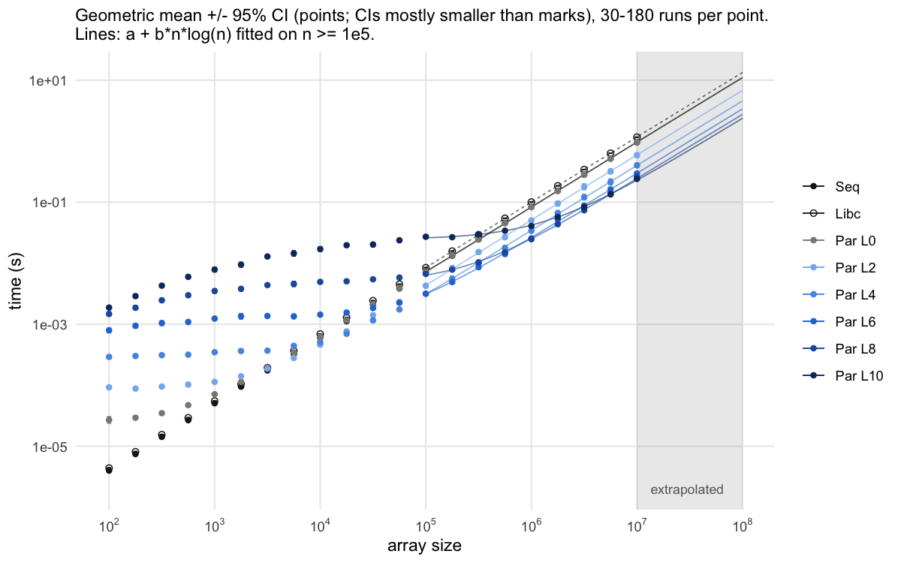
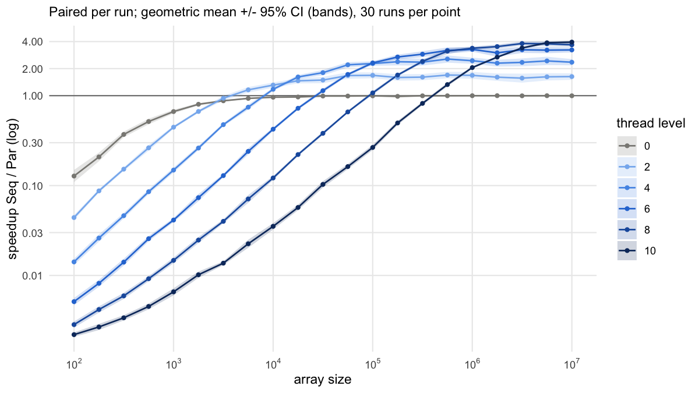

# Parallel Quicksort: Improving the Experimental Methodology

Changes made to the original setup (see [journal.org](journal.org)), in order.
Test machine: Apple M1 (4P+4E cores), macOS 14, Apple clang 15.

## 1. Code fixes

These issues biased *what* was being measured, so they had to be fixed before redesigning the experiment.

| # | Problem in original code | Consequence | Fix |
|---|---|---|---|
| 1 | `srand(time(NULL))` | Runs started within the same second sort the **same array** with the same pivots, so repetitions are not independent | Seed taken from the ns clock and printed; can be fixed with `argv[3]` for reproducibility |
| 2 | `rand()` called concurrently by all threads in `partition` | Data race (POSIX does not require `rand()` to be thread-safe); on glibc a lock serialises threads and inflates Par time | `rand_r()` with a private state per thread; child seeds derived from the parent's, so a run is deterministic given the seed |
| 3 | `THREAD_LEVEL` hard-coded to 10 | Always ~2047 thread creations, even for 100 elements; cannot be studied | Optional `argv[2]` (default 10, unchanged) |
| 4 | `gettimeofday` | 1 µs resolution while n=100 sorts take ~5 µs; wall clock can jump | `clock_gettime(CLOCK_MONOTONIC_RAW)`, printed with `%.9f` (falls back to `CLOCK_MONOTONIC`; on macOS the latter only has 1 µs resolution) |
| 5 | Built with `-O0` | Custom sorts are unoptimised but `qsort` comes from optimised libc. The conclusion flips with the flag: at `-O0` Seq ≈ Libc, at `-O2` Seq is ~20% faster | Makefile defaults to `-O2`; debug build via `make WARNINGS='$(PEDANTIC_PARANOID_FREAK)'` |
| 6 | `-lrt` in `CFLAGS` | Fails to link on macOS | Moved to `LIBS`, Linux only |
| 7 | `pthread_exit()` at the end of `main` | Hangs under ThreadSanitizer on macOS | `return 0` |

**Usage:** `./src/parallelQuicksort [size [thread_level [seed]]]`. Output gains a first line
`Size: N, Level: L, Seed: S`; the timing lines are unchanged, so the existing Perl extractors still work.

**Verification**
- Sorted output (no `Oops`, no crash) for sizes {0, 1, 2, 3, 100, 10⁶} × levels {0, 1, 5, 10, 12}.
- Warning-free with the pedantic flags (clang), and with `gcc-14 -Wall -Wextra`.
- Back-to-back runs now get different seeds.
- Timer resolution is now 42 ns (the M1's 24 MHz counter).
- *Not tested:* the build on Linux.

## 2. Experimental design

Runner: `python3 scripts/run_benchmark.py [reps=30] [design_seed=42]`. It rebuilds the binary, then writes
`data/<host>_<date>/measurements_<HH-MM>.csv` and a matching `.info` file.
Code change: an optional 4th argument sets the algorithm order (a permutation of `spl`).

| | Original | New | Why |
|---|---|---|---|
| Sizes | 5, from 10² to 10⁶ in ×10 steps | 21, log-spaced from 10² to 10⁷ (4 per decade) | Locate the crossover and see the shape of the curves; 10⁷ shows the asymptotic regime |
| Thread level | 10 only | {0, 2, 4, 6, 8, 10} | Pilot: the best level is 4–8 depending on size. Level 0 (one thread, no split) isolates the thread-creation cost |
| Repetitions | 5 | 30 per (size, level) | Pilot CV of Par ≈ 15%, so the 95% CI is about ±5.6% of the mean. Seq/Libc vary less (CV < 2%) and get 180 runs per size |
| Run order | Sizes increasing, repetitions back to back | All 3780 runs shuffled (fixed seed) | Keeps drift (heat, background load) from lining up with any factor |
| Algorithm order within a run | Always Seq → Par → Libc | Rotates through the 6 orders across repetitions (5 of each per cell); position recorded | Removes, and lets us measure, order and cache effects |
| Input array | Seeded by the clock | Seed per (size, rep), shared across levels | Common random numbers: levels are compared on identical arrays; every run is reproducible |
| Output | Text, parsed with Perl | Long CSV: `run,size,level,rep,seed,algo,position,time` | Read directly by R |
| Metadata | None | `.info`: git commit, compile line, compiler, OS, CPU, power source, load average before/after, design, duration | Needed to interpret and compare runs |

**Run:** [`data/Ruxandras-MacBook-Air_2026-11-11/measurements_11-31.csv`](data/Ruxandras-MacBook-Air_2026-11-11/measurements_11-31.csv)
- 3780 runs (11 340 timings), 18 minutes, all outputs sorted.
- Balance confirmed: 30 reps per cell, and each algorithm 1260 times in each position.
- Load average rose from 2.4 to 3.0 during the run.

**Limitations:**
- One machine only.
- Laptop running on battery with normal background apps (load is recorded).
- Thread placement on the M1's performance vs efficiency cores is not controlled (macOS has no thread pinning).
- Seq and Libc are measured in every run, so they are oversampled. That is the cost of keeping paired measurements within each run.

## 3. Analysis

`Rscript scripts/analysis.R <csv>` prints the tables (saved in
[`measurements_11-31_analysis.txt`](data/Ruxandras-MacBook-Air_2026-11-11/measurements_11-31_analysis.txt))
and writes the figures next to the CSV.

**Method**

| | Original | New |
|---|---|---|
| Plot | Linear axes, raw points, no legend | ggplot on log–log axes, legend, 95% CI |
| Summary statistic | None | Geometric mean with a t-based CI on log(time), because times are positive and right-skewed |
| Speedup | Read off the plot | Paired per run (Seq/Par on the same array, in the same process) |
| Crossover | "≈ 400 000", read off a plot with no data between 10⁵ and 10⁶ | Size above which Par stays faster, interpolated on log–log axes; 95% CI from a bootstrap (1000 resamples of the runs in each cell) |
| Trend | None | `t = a + b·n·log₂n` fitted on log(t) for n ≥ 10⁵. Asymptotic speedup = b_Seq / b_Par |
| Checks | None | Effect of algorithm position within a run, and drift over the execution order |

| Thread level | Crossover n [95% CI] | Speedup at n = 10⁷ [95% CI] | Asymptotic speedup (fit) |
|---|---|---|---|
| 0 | none (≈ 1 for n ≥ 10⁴) | 1.00 [0.97, 1.02] | 1.00 |
| 2 | 3 800 [3 300, 4 200] | 1.63 [1.50, 1.77] | 1.62 |
| 4 | 8 100 [7 800, 8 500] | 2.36 [2.18, 2.56] | 2.41 |
| 6 | 27 000 [26 000, 28 000] | 3.23 [3.03, 3.45] | 3.26 |
| 8 | 92 000 [88 000, 98 000] | 3.68 [3.49, 3.88] | 4.01 |
| 10 | 400 000 [390 000, 410 000] | 3.95 [3.78, 4.11] | 4.70 |

**Findings**
1. **The original "≈ 400 000" holds only for level 10.** The crossover is set by the thread level and moves 100-fold between levels 2 and 10.
2. **Each thread costs about 12–24 µs to create and join.**
   - Level 0 (a single thread) adds 24 µs at n = 100.
   - Level 10 (~2047 threads) takes 27 ms at n = 10⁵, where Seq takes 7 ms.
   - For small n, fewer threads are created because the sub-arrays run out.
3. **The best level grows with n.**
   - It leaves roughly 10³–10⁴ elements per leaf thread, so `L ≈ log₂(n / 5000)`; neighbouring levels are often within each other's CI.
   - Below n ≈ 3 000, parallelism never pays.
4. **Maximum speedup is about 4** (3.95 at 10⁷) on 4 performance + 4 efficiency cores.
5. **At -O2, the custom Seq beats libc `qsort` by about 20%** (b ratio 0.83), probably because `qsort` calls the comparison function through a pointer.
6. **Variability:** the median coefficient of variation per cell is 17% for Par, against under 3% for Seq and Libc. That confirms Par needs the larger number of repetitions.
7. **Checks** ([drift figure](data/Ruxandras-MacBook-Air_2026-11-11/measurements_11-31_drift.png)):
   - Running second or third instead of first changes times by 1.3% or less (only Libc is significant, about +1%).
   - No significant drift: under 0.5% per 1000 runs.
   - The very first runs after the build were up to 3.6× slower. This is a warm-up effect; the shuffle spread it out, but warm-up runs would remove it.
8. **The extrapolation fails.** At n = 10⁸ (3 runs per level, [`extrapolation_check_1e8.csv`](data/Ruxandras-MacBook-Air_2026-11-11/extrapolation_check_1e8.csv)):
   - Seq is 6% slower than predicted, and Libc 17% slower.
   - The Par speedup is 3.0 (level 8) and 3.6 (level 10), against predictions of 4.0 and 4.7, and ranges from 1.9 to 4.4 across runs.
   - The 1.6 GB working set on an 8 GB laptop that was already swapping is a different memory regime. The model is only valid within the measured range (10⁵–10⁷).
   - The level-10 fit also overshoots the measured speedup at 10⁷ (4.70 vs 3.95), so the asymptotic speedups for levels 8 and 10 are unreliable.
